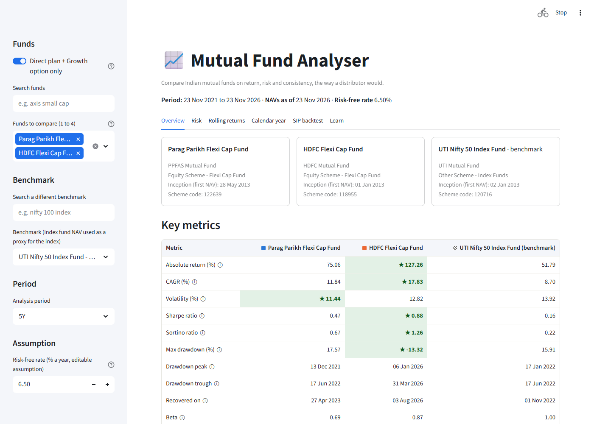
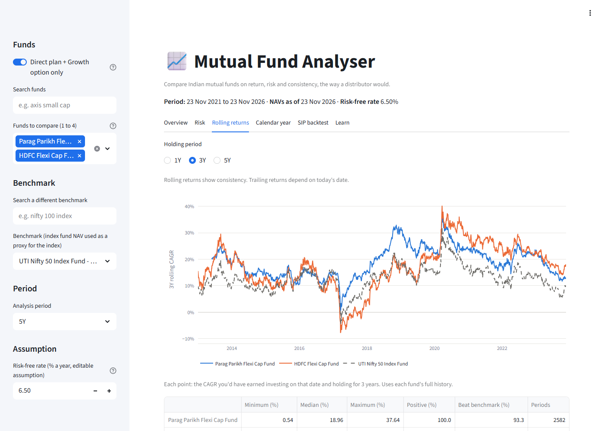
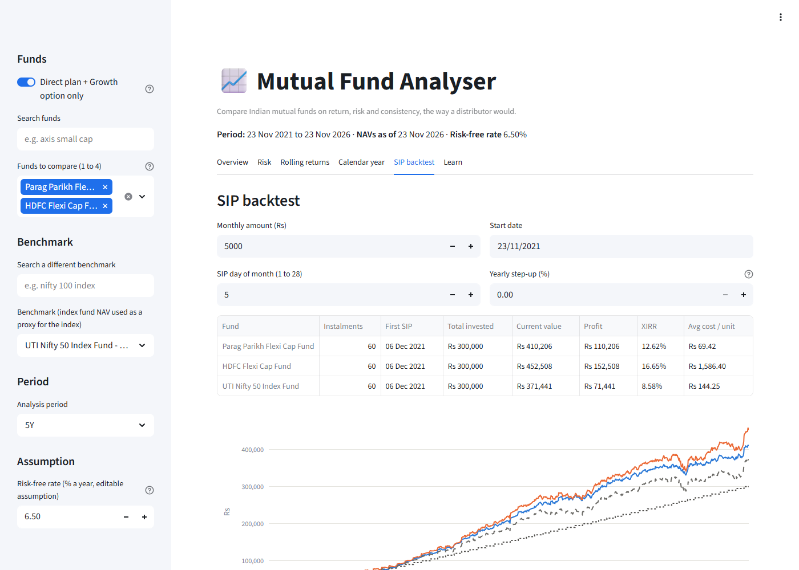

# 📈 Mutual Fund Analyser

Compare Indian mutual funds the way a distributor would when advising a client: on return, risk,
consistency and SIP outcomes, against a Nifty 50 benchmark. It uses free daily NAV data from
[mfapi.in](https://www.mfapi.in/) (38,000+ schemes, no API key).

**Live app:** _add your Streamlit Cloud link here after deploying_



| Rolling returns | SIP backtest |
|---|---|
|  |  |

## Features
- **Search** any scheme and compare 1 to 4 funds. A toggle keeps only Direct plan + Growth option results.
- **Benchmark:** a Nifty 50 index fund's NAV, used as a proxy for the index. You can change it.
- **Periods:** 1Y, 3Y, 5Y, 10Y, since inception, or custom dates. The risk-free rate can be edited (default 6.5%).
- **Overview:** fund cards and a metrics table. The best value in each row is starred, every metric has an ⓘ tooltip, and the table downloads as CSV. Also a growth-of-Rs-10,000 chart.
- **Risk:** drawdown chart and rolling 1-year volatility.
- **Rolling returns:** 1Y / 3Y / 5Y rolling CAGR, with min / median / max, % of periods positive and % that beat the benchmark.
- **Calendar year:** each year's return vs the benchmark.
- **SIP backtest:** monthly amount, start date, SIP day and yearly step-up. Shows invested, value, profit and XIRR.
- **Learn:** a plain-English glossary.

## Metrics explained
| Metric | Formula | What it tells a client |
|---|---|---|
| Absolute return | end NAV / start NAV − 1 | Total gain, ignoring time |
| CAGR | (end / start)^(365 / days) − 1 | Steady yearly growth rate (shown only for periods of 1 year or more) |
| Volatility | std(daily returns) × √252 | How bumpy the ride is |
| Sharpe ratio | (CAGR − rf) / volatility | Return earned per unit of total risk |
| Sortino ratio | (CAGR − rf) / downside deviation | Return earned per unit of *downside* risk |
| Max drawdown | worst fall from a peak to a later low | The worst loss an investor would have sat through, with peak, trough and recovery dates |
| Beta | cov(fund, bench) / var(bench), daily returns on common dates | Sensitivity to market moves |
| Jensen's alpha | CAGR − [rf + β × (bench CAGR − rf)] | Return beyond what the market risk taken explains |
| Rolling CAGR | CAGR for every N-year window | Consistency, independent of today's date |
| XIRR | rate where NPV of dated cash flows = 0 (bisection) | True annual return of a SIP |

**Assumptions:** NAV-based (expense ratio already deducted); no stamp duty, exit load or tax.
The benchmark is an index fund, so it trails the real index by its expense ratio and tracking error.

## Project structure
```
app.py               Streamlit layout only
src/data.py          API calls, cleaning, caching (scheme list 24h, NAVs 6h), search, date alignment
src/metrics.py       returns, CAGR, volatility, Sharpe, Sortino, drawdown, beta, alpha, rolling, calendar
src/sip.py           SIP backtest + XIRR (bisection)
src/charts.py        Plotly figure builders
src/ui.py            HTML metrics table + formatting
src/content.py       tooltips, glossary, footer text
tests/               50 pytest tests (known answers: CAGR, drawdown, XIRR, SIP)
```

## Run locally
```powershell
py -3.11 -m venv .venv
.\.venv\Scripts\Activate.ps1
pip install -r requirements.txt
python -m pytest           # run the tests
streamlit run app.py       # opens http://localhost:8501
```

## Deploy (Streamlit Community Cloud, free)
1. Push this folder to a public GitHub repo.
2. Go to [share.streamlit.io](https://share.streamlit.io), sign in with GitHub, and click **Create app**.
3. Pick the repo, branch `main`, main file `app.py`. Under **Advanced settings**, choose Python 3.11.
4. Click **Deploy**. To update the app later, `git push` to `main`; it redeploys automatically.

---
Past performance does not guarantee future returns. Educational project, not investment advice. Data: mfapi.in.
