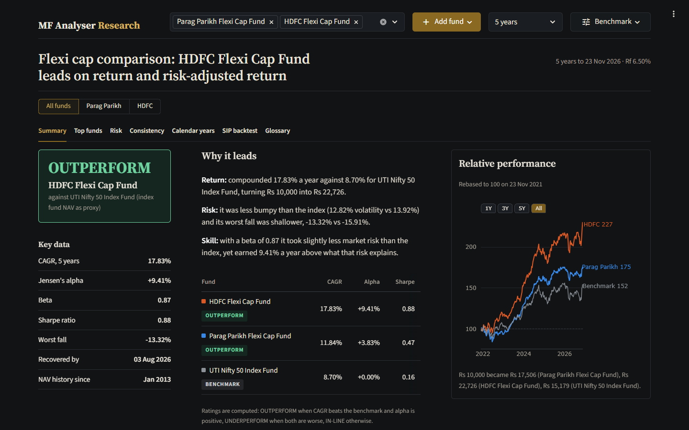
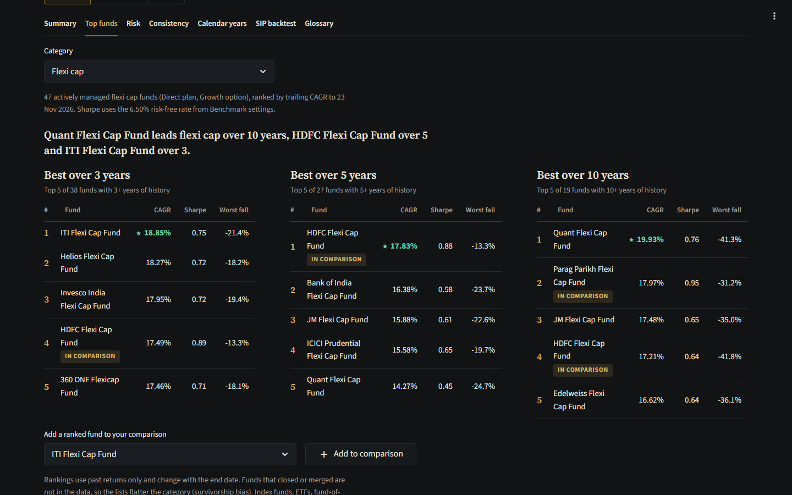
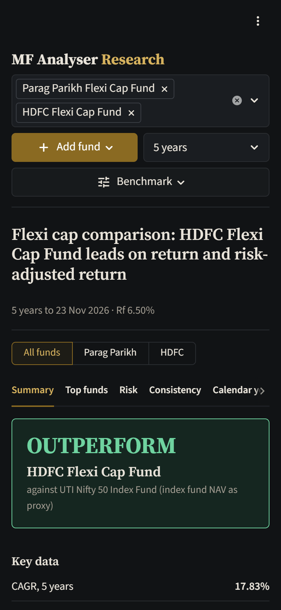
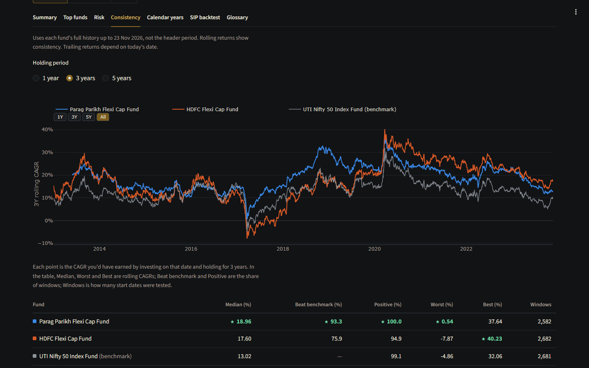

# 📈 Mutual Fund Analyser

Compare Indian mutual funds the way a distributor would when advising a client: on return, risk,
consistency and SIP outcomes, against a Nifty 50 benchmark. It uses free daily NAV data from
[mfapi.in](https://www.mfapi.in/) (38,000+ schemes, no API key).

**Live app:** _add your Streamlit Cloud link here after deploying_



| Top funds in a category | Phone |
|---|---|
|  |  |

| Consistency (rolling returns) | SIP backtest |
|---|---|
|  |  |

## Features
The app reads like a broker's research note ("Research Desk" design, dark theme; see [DESIGN.md](DESIGN.md)).
- **Header bar:** pick 1 to 4 funds, **Add fund** searches all schemes (a toggle keeps only Direct plan + Growth option), choose the period, and set the benchmark and risk-free rate.
- **Benchmark:** a Nifty 50 index fund's NAV, used as a proxy for the index. You can change it.
- **Periods:** 1Y, 3Y, 5Y, 10Y, since inception, or custom dates. The risk-free rate can be edited (default 6.5%).
- **Headline:** one sentence naming the leading fund, e.g. "Flexi cap comparison: HDFC Flexi Cap Fund leads on return and risk-adjusted return".
- **Summary:** a computed rating (OUTPERFORM when CAGR beats the benchmark and alpha is positive, UNDERPERFORM when both are worse, IN-LINE otherwise), key data, three plain-English reasons (return, risk, skill), a rating table and a relative-performance chart. Below it, the full metrics table: best values starred, a hover definition on every metric, CSV download.
- **Spotlight:** highlight one fund across every chart and table.
- **Client fit:** for a client meeting. Enter the client's risk appetite, goal and time horizon; the app follows an
  advisor's steps:
  1. Caps the risk where the horizon is short or the goal has a fixed date.
  2. Sets a growth / stability (equity / debt) split.
  3. Maps each part to fund categories (e.g. flexi, mid and small cap for long horizons; balanced advantage or
     short-duration debt for short ones; ELSS for tax saving; liquid funds for an emergency fund).
  4. Shortlists the best funds in each category by a fit score: percentile ranks on CAGR, Sharpe and worst fall,
     weighted for the client's risk level.
  5. Splits the client's monthly SIP and/or lump sum across the top pick of each category, in rupees (rounded to
     Rs 100, always adding up to the total). It flags amounts under common scheme minimums and suggests an STP
     for a large lump sum going into equity.

  Every rule is a small table in `src/advisor.py`, so each recommendation can be explained.
- **Top funds:** the top 5 funds of a category (equity: flexi, large, large & mid, mid, small cap, ELSS; hybrid and
  debt: balanced advantage, corporate bond, short duration, liquid) over 3, 5 and 10 years, ranked by CAGR with Sharpe and worst fall. Add any of them to the comparison in one click.
- **Risk:** drawdown chart and rolling 1-year volatility.
- **Consistency:** 1Y / 3Y / 5Y rolling CAGR, with worst / median / best, % of windows positive and % that beat the benchmark.
- **Calendar years:** each year's return vs the benchmark.
- **SIP backtest:** monthly amount, start date, SIP day and yearly step-up. Shows invested, value, profit and XIRR.
- **Glossary:** plain-English definitions with examples.
- Works on a phone (390px wide).

**Top funds caveats:** categories are matched by scheme name (the free data has no clean category field);
index funds, ETFs, fund-of-funds and international funds are excluded; funds that closed or merged are not
in the data, so the lists flatter each category (survivorship bias).

## Metrics explained
| Metric | Formula | What it tells a client |
|---|---|---|
| Absolute return | end NAV / start NAV − 1 | Total gain, ignoring time |
| CAGR | (end / start)^(365 / days) − 1 | Steady yearly growth rate (shown only for periods of 1 year or more) |
| Volatility | std(daily returns) × √252 | How bumpy the ride is |
| Sharpe ratio | (CAGR − rf) / volatility | Return earned per unit of total risk |
| Sortino ratio | (CAGR − rf) / downside deviation | Return earned per unit of *downside* risk |
| Max drawdown | worst fall from a peak to a later low | The worst loss an investor would have sat through, with peak, trough and recovery dates |
| Beta | cov(fund, bench) / var(bench), daily returns on common dates | Sensitivity to market moves |
| Jensen's alpha | CAGR − [rf + β × (bench CAGR − rf)] | Return beyond what the market risk taken explains |
| Rolling CAGR | CAGR for every N-year window | Consistency, independent of today's date |
| XIRR | rate where NPV of dated cash flows = 0 (bisection) | True annual return of a SIP |

**Assumptions:** NAV-based (expense ratio already deducted); no stamp duty, exit load or tax.
The benchmark is an index fund, so it trails the real index by its expense ratio and tracking error.

## Project structure
```
app.py               Streamlit layout only
src/data.py          API calls, cleaning, caching (scheme list 24h, NAVs 6h), search, categories, parallel fetch
src/metrics.py       returns, CAGR, volatility, Sharpe, Sortino, drawdown, beta, alpha, rolling, calendar,
                     rating, category leaderboard
src/sip.py           SIP backtest + XIRR (bisection)
src/advisor.py       Client fit: risk caps, allocation, categories, fit score
src/charts.py        Plotly figure builders (dark theme)
src/ui.py            page CSS, research-note blocks (headline, rating, thesis), HTML tables, formatting
src/content.py       tooltips, glossary, footer text
tests/               214 pytest tests (known answers: CAGR, drawdown, XIRR, SIP; every client-fit profile)
.streamlit/          theme (colours, fonts)
DESIGN.md            design system: colours, type, layout, rules
```

**Data:** `https://api.mfapi.in/mf` (every scheme's code and name) and `https://api.mfapi.in/mf/{code}`
(one fund's full daily NAV history). mfapi.in republishes AMFI's daily NAVs.

## Run locally
```powershell
py -3.11 -m venv .venv
.\.venv\Scripts\Activate.ps1
pip install -r requirements.txt
python -m pytest           # run the tests
streamlit run app.py       # opens http://localhost:8501
```

## Deploy (Streamlit Community Cloud, free)
1. Push this folder to a public GitHub repo.
2. Go to [share.streamlit.io](https://share.streamlit.io), sign in with GitHub, and click **Create app**.
3. Pick the repo, branch `main`, main file `app.py`. Under **Advanced settings**, choose Python 3.11.
4. Click **Deploy**. To update the app later, `git push` to `main`; it redeploys automatically.

---
Past performance does not guarantee future returns. Educational project, not investment advice. Data: mfapi.in.
